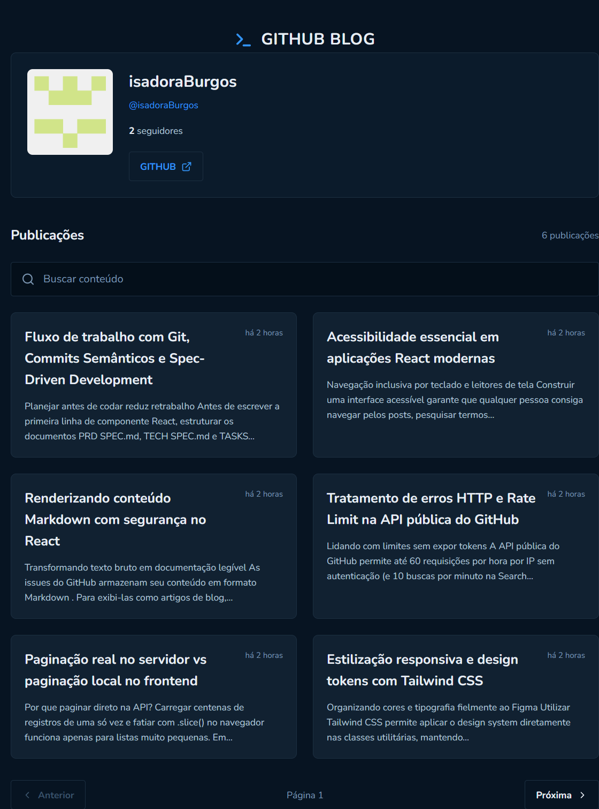
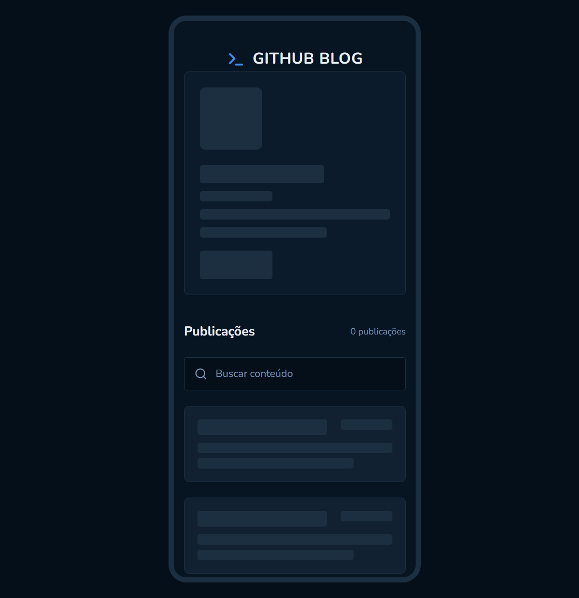

# GitHub Blog

## 1. Proposta

Blog estático cujas publicações são as **issues** do repositório [`isadoraBurgos/GitHub-Blog`](https://github.com/isadoraBurgos/GitHub-Blog), lidas diretamente da GitHub REST API. Os dados continuam no GitHub — inclusive o link canônico de cada post — e esta aplicação é apenas a vitrine editorial: criar uma issue é publicar.

A interface apresenta perfil, busca, paginação e leitura de Markdown, com estados claros de carregamento, limite da API e erro. Não há login, escrita de issues, CMS, backend ou banco de dados nesta versão.

**Referência ao Figma:** o protótipo de design é a fonte visual do projeto; cores, tipografia, escala e componentes mapeados estão versionados na [TECH_SPEC — seção 3](docs/TECH_SPEC.md). Link do arquivo Figma: _a preencher com a URL do protótipo compartilhado_.

## 2. Stack

- **Node 24 + npm** — ambiente local e CI.
- **React 19 + TypeScript ~5.9** — `strict`, `noImplicitAny`, `noUncheckedIndexedAccess` e zero `any`.
- **Vite 8** — dev server e build estático; `base: '/GitHub-Blog/'`.
- **Tailwind CSS v4** — via `@tailwindcss/vite`, tokens do Figma em `@theme` (`src/styles.css`).
- **React Router 7** — SPA com `/`, `/post/:number` e rota `*`.
- **Axios** — cliente HTTP com `params`, `timeout` e `AbortController`.
- **react-markdown + remark-gfm** — corpo das issues com GFM.
- **lucide-react** — ícones do banner, busca, perfil e ações.
- **Vitest + Testing Library + jsdom + MSW** — 13 arquivos de teste, com os três cenários da TECH_SPEC.

## 3. Configuração de `username` e `repo`

A fonte dos dados fica centralizada em `src/config/github.ts`:

```ts
export const GITHUB_API = 'https://api.github.com'

export const USERNAME = 'isadoraBurgos'

export const REPO = 'GitHub-Blog'

export const PER_PAGE = 6

export const SEARCH_DEBOUNCE_MS = 500
```

Para apontar o blog para outro usuário ou repositório, altere apenas `USERNAME` e `REPO`. `PER_PAGE` e `SEARCH_DEBOUNCE_MS` controlam, respectivamente, o tamanho da página e o debounce da busca.

> **Segurança:** não existe `VITE_GITHUB_TOKEN`, `.env` versionado, `localStorage` com token, header `Authorization` configurado pela aplicação nem segredo no bundle. Futuras autenticações exigiriam proxy/backend e revisão da TECH_SPEC.

## 4. Instalação e execução local

Pré-requisitos: Node 24 e npm.

```bash
npm ci
npm run dev
```

Abra `http://localhost:5173/GitHub-Blog/`. O prefixo `/GitHub-Blog/` aparece porque o `base` do Vite já mira o caminho do GitHub Pages.

Para validar exatamente o build de produção:

```bash
npm run build
npm run preview
```

 então acesse `http://localhost:4173/GitHub-Blog/`.

## 5. Scripts

| Comando | Script real | Uso |
| --- | --- | --- |
| `npm run dev` | `vite` | Dev server com HMR. |
| `npm run build` | `tsc -b && vite build` | Typecheck + bundle em `dist/`. |
| `npm run typecheck` | `tsc -b` | Checagem TypeScript dos projetos. |
| `npm run lint` | `eslint .` | ESLint com regras estritas e sem `any`. |
| `npm test` | `vitest run` | Executa os 13 arquivos / 47 testes uma vez. |
| `npm run preview` | `vite preview` | Serve `dist/` localmente. |

Não há script `test:watch` versionado: a watch mode do Vitest não faz parte do critério de entrega.

## 6. Arquitetura de pastas

```text
.
├── .github/workflows/ci.yml       # typecheck → lint → test → build
├── public/404.html                # deep links no GitHub Pages
├── docs/
│   ├── PRD_SPEC.md                # produto, RF-01..RF-16, RN-01..RN-10
│   ├── TECH_SPEC.md               # stack, tipos, endpoints, Figma, testes
│   ├── TASKS_SPEC.md              # T-01..T-27, validações e decisões
│   ├── AI_USAGE.md                # evidências de uso do OpenCode
│   └── screenshots/               # capturas da build de produção
├── index.html                     # lang pt-BR, Nunito 400/700
├── vite.config.ts                 # React, Tailwind, alias @/, base do Pages
├── vitest.config.ts               # jsdom, setupFiles, MSW
├── tsconfig*.json
└── src/
    ├── main.tsx                   # restaura deep link + BrowserRouter(basename)
    ├── App.tsx                    # rotas /, /post/:number, *
    ├── styles.css                 # @theme com os tokens do Figma
    ├── pages/                     # HomePage, PostPage, NotFoundPage (+ testes)
    ├── components/
    │   ├── layout/                # Header, Banner, Container
    │   ├── profile/               # ProfileCard, ProfileCardSkeleton
    │   ├── search/                # SearchInput
    │   ├── issues/                # IssueCard, IssueGrid, Pagination, skeletons
    │   ├── post/                  # MarkdownRenderer, PostCard
    │   └── feedback/              # ErrorState, RateLimitState, ErrorFeedback
    ├── hooks/                     # useProfile, useIssues, useDebouncedValue,
    │                              # useIssueSearch, useIssueDetail (+ testes)
    ├── services/                  # api.ts (Axios), githubService.ts
    ├── utils/                     # relativeDate, excerpt, filterIssues,
    │                              # buildSearchUrl, mapApiError (+ testes)
    ├── types/                     # github.ts, blog.ts, index.ts
    ├── config/github.ts           # GITHUB_API, USERNAME, REPO, PER_PAGE, debounce
    └── test/                      # handlers.ts e setup.ts do MSW
```

Regra de dependência: `pages → components/hooks → services → utils/config → types`. Componentes não chamam Axios diretamente e services não importam React.

## 7. Funcionalidades

| ID | Funcionalidade |
| --- | --- |
| RF-01 | Perfil com avatar significativo, nome, `@login`, bio, seguidores e empresa. |
| RF-02 | Banner escuro com `>_ GITHUB BLOG`, visível a partir de 320px. |
| RF-03 | Link externo `GITHUB` com `target="_blank" rel="noopener noreferrer"`. |
| RF-04 | Contador de publicações com plural correto. |
| RF-05 | Busca com debounce de 500ms; limpar o campo volta à listagem. |
| RF-06 | Paginação real no servidor com `per_page=6`. |
| RF-07 | Cards com título, resumo, data relativa em pt-BR e hover. |
| RF-08 | Navegação SPA para `/post/:number`, com scroll ao topo. |
| RF-09 | Detalhe com `VOLTAR`, `VER NO GITHUB`, título e corpo completos. |
| RF-10 | Markdown com GFM: títulos, listas, links, `code` e blocos de código. |
| RF-11 | Metadados `@autor`, data relativa e plural de comentários. |
| RF-12 | Rota `*` com mensagem amigável e botão “Voltar à Home”. |
| RF-13 | Skeletons durante carregamento e aborto ao desmontar. |
| RF-14 | `403/429` sem loop, sem token e sem detalhe técnico. |
| RF-15 | `404` e erro de rede com mensagens amigáveis e retry manual. |
| RF-16 | Grid de 1 coluna no mobile e 2 no desktop, foco `blue`, contraste AA. |

Regras de negócio aplicadas:

| ID | Regra |
| --- | --- |
| RN-01 | Pull Requests nunca aparecem na listagem ou busca. |
| RN-02 | `state=all&sort=created&direction=desc`. |
| RN-03 | `per_page=6`, `page` enviada ao servidor e total via `Link`/Search API. |
| RN-04 | Termo de busca codificado com segurança. |
| RN-05 | Debounce de 500ms com aborto da requisição anterior. |
| RN-06 | `403/429` mapeado para aviso amigável; retry apenas manual. |
| RN-07 | 404 amigável em perfil, repositório, issue ou rota inexistente. |
| RN-08 | Erro de rede sem `stack`, headers ou JSON bruto. |
| RN-09 | Nenhum token no frontend; autenticação futura exigiria proxy. |
| RN-10 | Datas relativas em pt-BR (`há 2 dias`) com fallback determinístico. |

## 8. Decisões técnicas

- **Tailwind v4 com `@theme`:** os tokens do Figma viram utilitários (`bg-base-post`, `text-blue`) sem arquivo de configuração separado; nenhuma cor ou tamanho foi inventado.
- **API pública sem token:** limite de 60 requisições/hora por IP. Isso é tratado como estado de UI em `403/429`, não como erro técnico, e nunca como header `Authorization`.
- **Search API x filtro local:** sem termo, a app usa `/repos/.../issues` e remove itens com `pull_request`; com termo, usa `/search/issues?q=repo:... is:issue ...`, para que total e paginação sejam feitos no servidor.
- **Estado na URL:** `?q=` e `?page=` são a fonte da busca e da paginação. Isso preserva o retorno do detalhe e dispensa estado global (Redux/Context).
- **Axios + `AbortController`:** `params` codifica a query; cada efeito aborta a request anterior. `useDebouncedValue` só atrasa o valor; os hooks de dados fazem o cancelamento.
- **Cache curto:** perfil e detalhe ficam em memória por 60 segundos. Listagem e busca não são cacheadas, para refletir edições nas issues.
- **Erros traduzidos:** `mapApiError` converte falhas em `BlogError` amigável; nenhuma mensagem mostra `stack`, cabeçalhos, URL com segredo ou corpo bruto.
- **Markdown:** `react-markdown` + `remark-gfm` renderizam o corpo da issue sem plugins de HTML cru.
- **Deep links no Pages:** `base: '/GitHub-Blog/'`, `basename` derivado de `import.meta.env.BASE_URL` e `public/404.html` redirecionando para `?/=<caminho codificado>`, restaurado em `src/main.tsx`.
- **CI:** `.github/workflows/ci.yml` valida `npm ci`, typecheck, lint, test e build; não publica automaticamente para evitar efeito externo sem aprovação.

## 9. Dados e limites da API

- Endpoints usados: `GET /users/{username}`, `GET /repos/{username}/{repo}/issues`, `GET /search/issues` e `GET /repos/{username}/{repo}/issues/{number}`.
- Sem autenticação: 60 requisições/hora por IP.
- Cache de 60 segundos apenas para perfil e detalhe; listagem e busca não são cacheadas.
- `403/429` exibe o aviso de limite sem retry automático; falhas de rede viram mensagem amigável com botão “Tentar novamente”.
- Antes de publicar, confira `dist/`: `ghp_`, `github_pat_` e `VITE_GITHUB_TOKEN` não devem aparecer no bundle. As ocorrências de `Authorization` no bundle são apenas nomes de header na biblioteca Axios, sem valor de segredo.

## 10. Deploy

- O build gera `dist/` com assets prefixados por `/GitHub-Blog/assets/`.
- `public/404.html` cobre o refresh direto em rotas como `/GitHub-Blog/post/42?q=runtime`.
- Em hosts com rewrite `/* → /index.html`, o `404.html` não é necessário.
- A publicação pode ser feita pelo GitHub Pages (Actions ou configuração manual do branch) por outro host estático.

## 11. Capturas de tela

Capturas da build de produção, com as issues reais do repositório — por isso os títulos diferem das fixtures dos testes.

| Home — desktop | Home — 375px | Detalhe da publicação |
| --- | --- | --- |
|  |  |  |

Arquivos: [`home-desktop.png`](docs/screenshots/home-desktop.png), [`home-mobile.png`](docs/screenshots/home-mobile.png) e [`post-detail.png`](docs/screenshots/post-detail.png).

## 12. Aplicação publicada

**Link da aplicação publicada:** _a preencher após o deploy_.

Endereço previsto no GitHub Pages: `https://isadoraburgos.github.io/GitHub-Blog/`.

## 13. Documentação

- [PRD_SPEC.md](docs/PRD_SPEC.md) — produto, fluxos, RF-01..RF-16 e RN-01..RN-10.
- [TECH_SPEC.md](docs/TECH_SPEC.md) — stack, tipos, endpoints, Figma, acessibilidade e testes.
- [TASKS_SPEC.md](docs/TASKS_SPEC.md) — checklist 27/27, log de validações e desvios.
- [AI_USAGE.md](docs/AI_USAGE.md) — três evidências detalhadas de uso do OpenCode.
