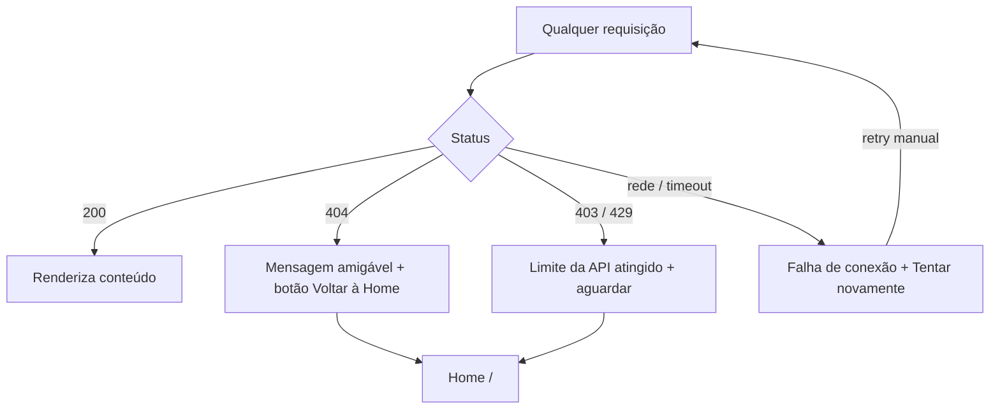

# PRD_SPEC — GitHub Blog

**Versão:** 1.0 — 25/11/2026
**Repositório:** https://github.com/isadoraBurgos/GitHub-Blog
**Owner / usuário GitHub:** `isadoraBurgos`
**Repo de issues:** `GitHub-Blog`
**Fonte de design:** protótipo Figma (tokens e telas transcritos em `docs/TECH_SPEC.md`)

> Documento de produto. Toda implementação deve rastrear um RF e respeitar um RN. Em caso de dúvida, consulte `AGENTS.md`.

---

## 1. Contexto

Hoje as issues do repositório `isadoraBurgos/GitHub-Blog` só podem ser lidas na interface do GitHub, que é pensada para desenvolvimento, não para leitura de conteúdo. O projeto propõe uma **vitrine editorial leve**: um blog estático cujos posts são as próprias issues do repositório, lidas diretamente da GitHub REST API.

O protótipo Figma define uma identidade visual escura (fundo `base-background`, superfícies `base-profile` e `base-post`, acento `blue`) com um banner de terminal e cards flutuantes. A experiência deve parecer um blog, mas os dados continuam no GitHub — inclusive o link canônico de cada publicação.

Como a API pública sem token limita a 60 requisições/hora por IP, o produto precisa ser econômico em chamadas, cachear o que for possível em memória da sessão e degradar com elegância quando o limite for atingido.

## 2. Objetivo

Entregar uma aplicação React/TypeScript que:

1. Apresente o perfil de `isadoraBurgos` e as issues do repositório `GitHub-Blog` como publicações.
2. Permita **buscar** e **paginar** no servidor, com no máximo 6 itens por página.
3. Abra cada publicação em uma rota SPA (`/post/:number`) com corpo Markdown formatado.
4. Ofereça estados de carregamento, erro, limite de API e rota 404 claros e acessíveis.
5. Respeite integralmente os tokens do Figma e seja utilizável em desktop e mobile.

**Não objetivo:** criar ou editar issues no GitHub pela aplicação, autenticação de usuário, edição de conteúdo, CMS próprio.

## 3. Público-alvo

| Público | Necessidade | Impacto no produto |
| --- | --- | --- |
| Leitores técnicos (devs, estudantes) | Ler artigos curtos publicados como issues | Leitura confortável, Markdown com código, contraste AA |
| Visitantes do repositório | Entender o projeto rapidamente | Bio + link `GITHUB` no card de perfil |
| Mantenedora (`isadoraBurgos`) | Publicar sem ferramenta extra | Criar uma issue = criar um post |
| Usuários mobile | Ler no celular | Grid de 1 coluna, alvos de toque, foco visível |

## 4. Fluxos

### 4.1 Fluxo principal — Home → Busca → Detalhe → Voltar

```mermaid
flowchart LR
  A[Home /] --> B[Card de perfil + Publicações]
  B --> C[Buscar conteúdo]
  C -->|debounce 500ms| D[Search API is:issue]
  B --> E[Lista paginada per_page=6]
  D --> E
  E -->|clicar no card| F[/post/:number]
  F --> G[Markdown + metadados]
  G -->|VOLTAR SPA| A
  G -->|VER NO GITHUB| H[github.com externo]
```

1. Usuário abre `/`. A aplicação carrega perfil e a página 1 das issues em paralelo.
2. Usuário digita no campo "Buscar conteúdo". Após 500ms de inatividade, a listagem é substituída pelos resultados da Search API; a paginação volta para `page=1`.
3. Usuário clica em um card. A URL muda para `/post/:number` via React Router (sem reload) e o corpo completo é exibido.
4. Usuário clica em `< VOLTAR` e retorna à Home. **O termo buscado e a página devem ser preservados** via query string (`/?q=...&page=...`).

### 4.2 Fluxo de erro / 404



- Uma issue inexistente em `/post/:number` cai no mesmo estado 404 amigável da rota curinga `*`.
- Nenhum fluxo exibe token, cabeçalhos, stack trace ou JSON bruto.

---

## 5. Requisitos Funcionais (RF-01 → RF-16)

| ID | Requisito | Critério de aceite verificável |
| --- | --- | --- |
| **RF-01** | Carregar e exibir o perfil de `isadoraBurgos` na Home. | **Dado** que `GET /users/isadoraBurgos` responde 200, **quando** a Home monta, **então** o card mostra avatar (`alt` com o nome), nome, `@login`, bio, `followers` e empresa se houver; durante a requisição há skeleton. |
| **RF-02** | Exibir header/banner escuro com logo centralizada. | **Quando** qualquer rota carrega, **então** há uma faixa de fundo `base-background` com arte escura e o texto `GITHUB BLOG` centralizado precedido do ícone de terminal `>_`, visível a partir de 320px de largura. |
| **RF-03** | Link externo para o GitHub no perfil. | **Quando** o usuário clica em `GITHUB`, **então** abre `https://github.com/isadoraBurgos` em nova aba com `rel="noopener noreferrer"` e ícone de link externo (`lucide-react`). |
| **RF-04** | Mostrar contador de publicações ao lado do título "Publicações". | **Dado** `total_count` da Search API (ou total calculado no modo lista), **então** o cabeçalho exibe "Publicações" à esquerda e o número à direita, com plural correto: `1 publicação` / `N publicações`. |
| **RF-05** | Buscar conteúdo com input e debounce. | **Dado** o placeholder exato "Buscar conteúdo", **quando** o usuário digita e para por 500ms, **então** uma única requisição de busca é disparada; ao limpar o campo, a listagem original (sem termo) retorna e `page` volta a 1. |
| **RF-06** | Paginação real no servidor. | **Quando** a Home carrega, **então** a request contém `page=1&per_page=6`; clicar em "Próxima" gera `page=2&per_page=6` e troca os 6 cards; "Anterior" é desabilitado na página 1 e "Próxima" na última página. Nunca há fatiamento local de um array maior. |
| **RF-07** | Cards de publicação com título, data e resumo. | **Cada card** usa `base-post`, contém título, resumo truncado, data relativa em português à direita, e ao hover a borda passa a `base-label`; o card inteiro é clicável por mouse e teclado. |
| **RF-08** | Navegação SPA para o detalhe. | **Quando** o usuário ativa um card, **então** a URL vira `/post/{number}` sem recarregar a página (assertado com MemoryRouter em teste) e o scroll volta ao topo. |
| **RF-09** | Tela de detalhe da issue. | **Dado** `/post/42`, **então** um card flutuante `base-profile` exibe `< VOLTAR` (SPA), `VER NO GITHUB` (externo), o título da issue e o corpo completo; se a issue não existe, exibe 404 amigável. |
| **RF-10** | Renderizar Markdown com GitHub Flavored Markdown. | **Quando** o corpo contém títulos, links, listas, `code` inline e blocos de código, **então** todos são renderizados com `react-markdown` + `remark-gfm`; links externos abrem em nova aba e blocos de código usam fundo `base-input`. |
| **RF-11** | Metadados do detalhe. | **No card de detalhe**, são exibidos autor no formato `@login`, data relativa em português e `N comentário` / `N comentários` (plural correto). |
| **RF-12** | Rota 404 amigável. | **Dado** uma URL fora das rotas conhecidas (ex.: `/nao-existe`), **então** aparece mensagem amigável e um botão "Voltar à Home" que navega para `/` sem reload. |
| **RF-13** | Estados de carregamento com skeleton. | **Enquanto** perfil, lista, busca ou detalhe está pendente, **então** há placeholder com a mesma geometria do conteúdo final; ao desmontar o componente, a requisição é abortada via `AbortController`. |
| **RF-14** | Tratamento de rate limit (403/429). | **Dado** resposta 403 ou 429, **então** a UI mostra "Limite da API do GitHub atingido. Aguarde alguns minutos e tente novamente."; não há retry automático em loop e nada de token/stack é exibido. |
| **RF-15** | Tratamento de 404 e erro de rede. | **Dado** 404 **então** "Publicação não encontrada" com botão de voltar; **dado** falha de rede/timeout **então** "Não foi possível carregar o conteúdo" com botão "Tentar novamente" (retry manual, sem exposição de detalhes técnicos). |
| **RF-16** | Responsividade e acessibilidade básica. | **Em viewport < 768px** o grid tem 1 coluna; **≥ 768px** tem 2 colunas. Foco visível sempre em `blue`, navegação por Tab/Enter funciona, e os pares texto/fundo atingem contraste AA (WCAG 2.1). |

## 6. Regras de Negócio (RN-01 → RN-10)

| ID | Regra | Critério de aceite verificável |
| --- | --- | --- |
| **RN-01** | **Excluir Pull Requests.** Toda listagem/busca deve conter `is:issue` (Search API) **ou** filtrar localmente o campo `pull_request` quando usar a rota de issues. | **Dado** uma issue e um PR no mesmo intervalo, **então** o PR nunca aparece no grid nem no contador. Teste com fixture contendo `pull_request` valida a remoção. |
| **RN-02** | Ordenação e estado fixos. | Requisições usam `state=all&sort=created&direction=desc`; issues abertas e fechadas aparecem, da mais recente para a mais antiga. |
| **RN-03** | **Paginação real no servidor.** | `per_page=6` é constante; `page` começa em 1 e é enviado ao servidor. O total vem de `total_count` (Search) ou do header `Link` (lista); nunca se faz `.slice()` de uma lista maior. |
| **RN-04** | **Busca codificada com segurança.** | O termo é enviado via `params` do Axios e/ou `encodeURIComponent` na query `q=repo:isadoraBurgos/GitHub-Blog is:issue <termo>`. Termos com `&`, `/`, `#`, acentos ou aspas não quebram a URL nem injetam qualificadores extras. |
| **RN-05** | Debounce e cancelamento. | Debounce de **500ms**; cada nova digitação aborta a request anterior com `AbortController`; respostas obsoletas nunca sobrescrevem a UI (verificação com `signal.aborted`). |
| **RN-06** | **Rate limit 403/429.** | Respostas 403/429 são mapeadas para erro amigável (RF-14), sem token, sem stack e sem polling agressivo. O retry é sempre manual. |
| **RN-07** | 404 em qualquer recurso. | Perfil, repositório, issue ou rota inexistente produzem a mesma experiência amigável com caminho de volta à Home; nunca uma tela em branco. |
| **RN-08** | Erro de rede sem vazamento. | Timeouts, CORS e falhas de DNS viram "Não foi possível carregar o conteúdo". A mensagem não inclui `error.response.config.headers`, URL com token nem `JSON.stringify(error)`. |
| **RN-09** | **Nenhum token no frontend.** | Não existe `VITE_GITHUB_TOKEN`, `.env` com segredo, token em `localStorage` ou token no bundle. A app usa a API pública; futura autenticação exigiria proxy e revisão da TECH_SPEC. |
| **RN-10** | Datas relativas em português. | `Intl.RelativeTimeFormat('pt-BR')` gera "há 2 dias", "há 1 hora", "há 3 meses"; para datas muito antigas ou inválidas há fallback em `Intl.DateTimeFormat('pt-BR')`. Nunca aparece "2 days ago". |

## 7. Escopo

### Incluído (v1)

- Rotas `/`, `/post/:number` e `*` (404).
- Consumo da GitHub REST API pública: perfil, listagem, busca e detalhe.
- Design system completo extraído do Figma (cores, Nunito, escala tipográfica, cards flutuantes, banner).
- Busca com debounce, paginação server-side, Markdown GFM, estados de loading/erro.
- Testes automatizados dos 3 cenários críticos e deploy estático.

### Excluído (v1)

- Login OAuth, escrita/criação/comentários em issues, edição de perfil.
- Backend, banco de dados, cache persistente em servidor, SSR.
- Internacionalização completa (a UI é em pt-BR; datas em pt-BR).
- Temas claro/escuro alternáveis, animações complexas, virtualização de listas.
- Paginação por número arbitrário (apenas Anterior/Próxima) e ordenação configurável pelo usuário.
- Métricas/analytics e notificações push.

## 8. Restrições de origem

- Figma é a **única** fonte de verdade visual. Tokens e componentes estão replicados em `docs/TECH_SPEC.md`; qualquer divergência deve ser corrigida na spec antes do código.
- O repositório de issues é o mesmo `GitHub-Blog` do usuário `isadoraBurgos`; não há configuração multi-repo nesta versão.
- Limite da API não autenticada (60 req/h/IP) é uma restrição de produto, não um bug.
